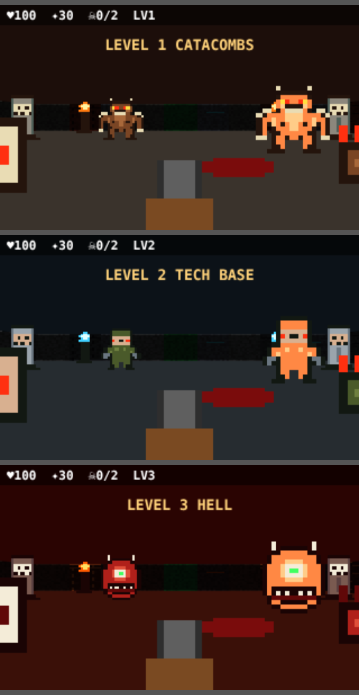

# 🔥 TIPO DOOM

A first-person shooter that lives right inside a Telegram message. It's an HTML widget (Bot API 10.4): a canvas raycaster, pixel-art monsters and random mazes. The world changes with every level, from the catacombs to a tech base to hell, then round again, harder each time.

<p align="center">
  
</p>

The whole game is **under 4 KB compressed**, which is the main size limit for Telegram widgets. The widget holds only the code. The art (palette, sprites, monster stats) comes from the bot: level 1 ships as the message's `public_data`, and each later level arrives as the answer to the widget's `lv:N` request.

---

## Quick start (Docker)

```bash
cp .env.dist .env          # put your BOT_TOKEN from @BotFather here
docker compose up -d --build
docker compose logs -f     # follow the logs
```

Then send `/start` or `/doom` to the bot.

> ⚠️ Widgets work **only in a private chat with the bot**, and only in Telegram clients that support Bot API 10.4 (layer 233+). Older clients show "unsupported message".

### Handy commands

| What | Command |
|---|---|
| Start / rebuild | `docker compose up -d --build` |
| Logs | `docker compose logs -f bot` |
| Restart | `docker compose restart bot` |
| Stop | `docker compose down` |
| Build the image without `.env` | `docker build -t tipo-doom-bot .` |
| One-off run without Compose | `docker run --rm --env-file .env tipo-doom-bot` |

The image is about 176 MB. It's a two-stage build: git is needed only to install aiogram and is left out of the final image. The bot runs as an unprivileged user. Only `doom_bot.py`, `themes.py` and the built `widgets/doom.html` go into the image.

## Running without Docker

```bash
python -m venv .venv && source .venv/bin/activate
pip install -r requirements.txt
BOT_TOKEN=123:ABC python doom_bot.py
```

> **aiogram with Bot API 10.4** is only available in [PR #2004](https://github.com/aiogram/aiogram/pull/2004) (3.32.0) for now. `requirements.txt` pins it to a commit. Once it's released, replace that line with `aiogram>=3.32`.

## Environment variables

| Variable | Required | Description |
|---|---|---|
| `BOT_TOKEN` | yes | bot token from @BotFather |

---

## Controls

| Button | Action |
|---|---|
| ▲ ▼ | move forward / back |
| ◀ ▶ | step sideways |
| ⟲ ⟳ | turn |
| FIRE | shoot (hold for auto-fire); starts the game on the title screen |

You can slide your finger from button to button and use both thumbs at once. Find the **green door** to finish a level.

---

## Development

```
doom_bot.py          the bot: /start, /doom → intro + widget; widget_query "lv:N" → level pack
themes.py            level themes (palette, sprites, colours, stats); pack(level) ≤ 1024 B
src/doom.html        readable game source (edit this one)
widgets/doom.html    built widget (don't edit by hand!)
minify.py            src → widgets (JS via npx terser)
check_widgets.py     checks size limits and forbidden constructs
```

### Edit cycle

```bash
# 1. edit src/doom.html and/or themes.py
python minify.py          # needs Node.js for npx terser
python check_widgets.py   # 32 KB / 4 KB zlib limits, theme packs ≤ 1024 B
docker compose up -d --build
```

### Adding a theme

Add a dictionary to `THEMES` in `themes.py`. The widget code doesn't need any changes. Themes cycle: `THEMES[(level-1) % len]`. A theme pack must fit in 1024 bytes, and `check_widgets.py` checks that.

| # | Theme | Monster | HP / speed / damage |
|---|---|---|---|
| 1 | CATACOMBS | imp | 2 / 1.1 / 6 |
| 2 | TECH BASE | zombie soldier | 3 / 1.4 / 8 |
| 3 | HELL | cacodemon | 5 / 0.8 / 14 |

---

## Telegram widget limits (cheat sheet)

| What | Limit |
|---|---|
| Widget HTML | ≤ 32 KB and **≤ 4096 bytes after zlib level 9** |
| `public_data`, `chat_data`, bot answer | ≤ 1024 bytes |
| Answering a `widget_query` | within 15 s |
| `request()` from the widget | 1–64 bytes; background requests only in private chats, at most once per 5 s |
| Canvas | ≤ 4000 commands per task |
| CPU | > 500 ms of continuous JS and the widget is killed |
| Memory | 8 MB |

**Not allowed:** `<input>`/`form`/`select`, network (`fetch`, WebSocket), external scripts and stylesheets, `getImageData`, `shadowBlur`, `ctx.filter`, keyboard.
**Gestures:** a vertical drag is always taken over by chat scrolling.

Spec: [TelegramMessenger/widget-sandbox](https://github.com/TelegramMessenger/widget-sandbox) (`docs/sdk-v1.md`, `docs/profile-v1.md`).
